# claude-tree

[한국어](README.ko.md)

See the flow of a long [Claude Code](https://claude.com/claude-code) session at a glance.

A session that runs for days drifts through planning, digressions, dead ends and rewinds. When you come back, scrolling up to re-orient takes a while. `claude-tree` reads the session transcript, asks a small model (Haiku) to group it into units of work, and prints the result as a tree in your terminal.

<p align="center"></p>

`✔` done · `●` in progress · `✗` abandoned · `↩` discarded by rewind

> **Note:** titles, summaries and messages are currently in Korean. Making the language configurable is a welcome contribution.

## Features

- **Stays out of your session.** The main Claude Code session never knows about the tree. `claude-tree` only reads the transcript file, so it uses none of your session's context.
- **Units of work, not messages.** Several prompts that belong to one task become one node. A long autonomous turn is split into steps at Claude's progress messages.
- **Incremental.** Only prompts added since the last run are sent to Haiku. Finished phases are frozen; the latest phase is re-organized with new work.
- **Knows about rewinds.** Work you discarded with rewind (`Esc Esc`) is kept as `↩` when it was substantial and dropped when it was just an edited prompt. Compactions are followed transparently.

## Requirements

- [Claude Code](https://claude.com/claude-code) CLI, logged in. Haiku is called through `claude -p`, so it uses your existing Claude login (no API key needed) and counts toward your usage.
- Python 3.9+ (standard library only)
- macOS or Linux

## Install

```sh
git clone https://github.com/JooseongMo0n/claude-tree.git
ln -s "$PWD/claude-tree/bin/claude-tree" ~/.local/bin/claude-tree   # any directory on your PATH
```

Set `CLAUDE_TREE_PYTHON` if `python3` on your PATH is older than 3.9.

## Usage

Run it in a **separate terminal tab** from the project directory:

```sh
claude-tree              # tree of the most recent session in this directory
claude-tree -v           # also print a one-line summary per node
claude-tree --pick       # choose from recent sessions (🌳 = already has a tree)
claude-tree --session ID # a specific session
claude-tree off          # delete this session's cached tree
```

- The first run on a session takes a while (long sessions: 1–2 minutes). Later runs show the previous tree immediately, update it, and redraw.
- In a terminal, each run clears the screen (like `clear`) so repeated runs don't pile up.
- Don't run it from inside the main session with `!claude-tree`: the output would land in the conversation and use context.

## How it works

1. **Parse** `~/.claude/projects/<project>/<session>.jsonl`. Follow the live branch from the latest message back through `parentUuid` (and `logicalParentUuid` across compactions). Prompts not on that branch were discarded by rewind.
2. **Condense** each prompt into a few lines: the prompt, Claude's final reply, tools used, files edited. Long turns become several steps.
3. **Organize** with Haiku (`claude -p --model haiku --no-session-persistence --tools "" --json-schema …`, hooks disabled). Haiku returns a pre-order list of nodes with depth and start position. At most 60 units are sent per call.
4. **Cache** the result in `~/.claude-tree/<session>.json`. The last top-level phase stays provisional and is redone together with new prompts next time.

| File | Role |
|---|---|
| `claude_tree/transcript.py` | Transcript parsing, rewind detection, step splitting |
| `claude_tree/segment.py` | Haiku prompt, windowed organizing, node ranges |
| `claude_tree/store.py` | Cache, lock, update decisions |
| `claude_tree/cli.py` | Tree rendering, spinner, CLI |

## Caveats

- The transcript format is not a documented Claude Code API. If an update breaks parsing, `transcript.py` is the place to look.
- Excerpts of your conversation (prompts, replies, file names) are sent to Haiku through your own Claude Code login. Nothing else leaves your machine.

## Contributing

Issues and pull requests are welcome. Some ideas:

- Configurable output language
- `--watch` mode that redraws every few minutes
- Better granularity heuristics for very long sessions

## License

[MIT](LICENSE)
